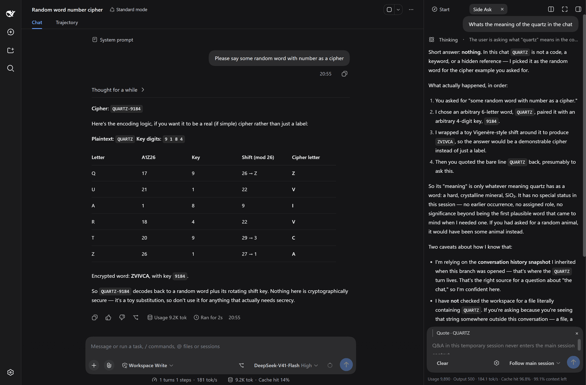
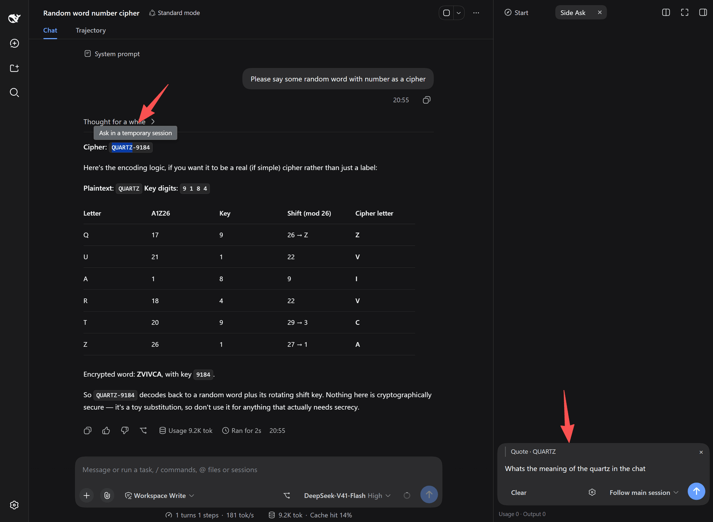
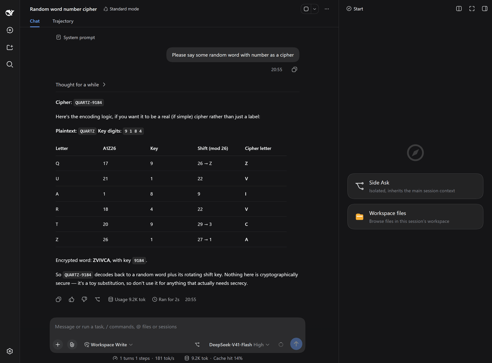

# Side Ask · DSH Side Branch

[](https://www.npmjs.com/package/dsh-side-branch)
[](https://www.npmjs.com/package/dsh-side-branch)
[](LICENSE)
[](https://github.com/deepseek-ai/deepseek-harness)

English | [简体中文](./docs/README.zh-CN.md)

**Quote any passage in the main session and ask about it in a read-only branch in the right sidebar. The answer streams there — and never enters the main session's model context.**

You know the moment: the agent is mid-refactor and you just want to ask "where else is this function used?" — without the main session remembering the question, and without re-processing a long, expensive context for a side query.

- Ask about the current conversation without adding a token to it.
- Point the branch at a cheaper model while the main session keeps the expensive one.
- Let a long task keep running, and ask something unrelated on the side.

```bash
dsh plugin --profile web add dsh-side-branch
# then restart DSH — client plugins load at startup; refreshing the browser is not enough
```

`--profile` should be the profile you actually run (`web`, `desktop`, …). Requires Node.js ≥ 20 and `pnpm` on your `PATH`.

> **Written by the agent itself.** Every line of code in this repository was written by DSH in a real session. The author's part was the workflow: setting the direction, reviewing the plans, and verifying the behaviour by hand. See [How this was built](#how-this-was-built).

<p align="center">
  
</p>

## What makes it different

**The answer never comes back.** The host never writes the branch's output into the parent session. What you ask in the branch stays in the branch — the main agent will not suddenly "know" what you discussed on the side.

**It cannot touch your files.** Read-only is enforced when a tool is *called*, not by hiding tools from the prompt. `ctx.tools.guard()` passes six side-effect-free tools (`read`, `glob`, `grep`, `web_search`, `web_fetch`, `lsp`) and refuses everything else. Because the tools stay in the prompt, the branch's prompt prefix is byte-identical to the main session's, so it keeps hitting the parent's prefix cache — measured 97%–98%, which is what makes a side question nearly free. Why it works this way, and what it costs, is in [`docs/TECHNICAL.md`](docs/TECHNICAL.md).

**It follows the main session.** Every follow-up rebuilds the branch from the main session's latest settled turns and replays the branch's own earlier questions and answers into it. A turn the main session just finished is already visible; something you asked three rounds ago is still remembered.

**You can inspect what it was given.** Expand *Inherited from the main session* to see, turn by turn, what the branch actually received — plus the preamble injected into its prompt, verbatim.

## Install

```bash
# npm
dsh plugin --profile web add dsh-side-branch

# or straight from GitHub
dsh plugin --profile web add github:wucl12/dsh-side-branch
```

Use the profile you actually run (`web`, `desktop`, …). **Then restart DSH** — client plugins load at startup, and refreshing the browser is not enough.

Prerequisites: Node.js ≥ 20, and `pnpm` on your `PATH` (`dsh plugin` forwards to pnpm).

Also available from a marketplace — [dsh-market](https://github.com/dsh-market/dsh-market) and the [awesome-dsh-plugin catalog](https://awesome-dsh-plugin.com) both list it.

> 🤖 **Prompt for AI agents:** if you are the agent installing this plugin or reading its source, read [`AGENTS.md`](AGENTS.md) first — it carries the hard constraints, the architecture, and the installation guide.

## How to use

1. **Ask via selection:** select text in the main session and click the pop-up **Quote and ask**. The branch opens in the right panel with the passage quoted. That passage is recorded with the round as a collapsible quote block, and the composer's quote slot clears itself so the next question starts clean.
2. **Quick entry:** the `↗` button to the right of the main session's input opens the panel directly (can be disabled in settings).
3. **Independent settings:** inside the panel you can give the current branch its own model and reasoning effort, without following the main session.

<p align="center">
  
</p>

<p align="center">
  
</p>

## Compatibility

| DSH | Status |
| --- | --- |
| `0.1.5-rc.2` | ✅ verified |
| `0.1.7-rc.2` | ✅ verified (archive gate) |
| `0.2.0-rc.2` | ✅ verified — loads, `/side-branch` routes register, panel exercised by hand |
| `0.2.1-rc.3` | ✅ verified — loads, `/side-branch` routes register and answer (200 / 405 + `Allow`), and the served client bundle carries the scoped quote entry |

The version-dependent seams (the archive gate, `unarchiveSession`) are feature-detected at runtime rather than compared by version number, which is why one published version serves all four. Details in [`docs/TECHNICAL.md`](docs/TECHNICAL.md).

The quote entry added in `0.2.2` needs the conversation-surface markers DSH renders around a session's body (`[data-conversation-content]`, or `[data-conversation-scroll]` on older hosts). On a host that renders neither, the entry stays hidden rather than guessing — everything else in the plugin is unaffected.

## Security & limitations

* **Read-only boundaries:** "read-only" here means **no system side effects** (no writing files, no running commands). `web_fetch` / `web_search` still have network access, and `read` can read any file the process can. The allowlist is hardcoded and cannot be relaxed through settings.
* **What the branch can see:** it is rebuilt from the main session's **latest settled turns**, so a turn the main session has finished follows along automatically. A turn it **has not finished yet** is not visible (the cut is the last `turn/end`) — but **quoting it by hand is unaffected**: the limit is on seeing it automatically, not on being able to quote it.
* **Rebuilds leave session records:** each rebuild creates a new side-session record, and the platform has **no API to delete a session**, so records accumulate. They are reclaimed by an orphan sweep at plugin startup, which logs what it deleted. While two instances share the same `DSH_HOME` and run at once, that sweep skips entirely — a second DSH never has its live branches deleted.
* **The context ceiling is a refusal:** on reaching it the plugin refuses the turn and asks you to clear; the oldest turns are never silently dropped. The `used` figure it reports is an **estimate**, so it will not match the real usage once a turn settles.
* **Cache hits are measured, not guaranteed:** 97%–98% is a measurement, not a promise — the platform may replace the system node in place on the branch's first step, invalidating the cache from token 0 on. And hitting the cache does not mean those tokens stop occupying the context window.
* **PTC mode:** if the main session uses the `ptc` preset (a code-execution-only tool surface), the branch falls back to plain text Q&A, because `run_code` is always refused.

## How it compares

Side-chat plugins here differ mainly in where the answer ends up and what the side session is allowed to do.

| | **Side Ask** (`dsh-side-branch`) | [`dsh-sidebar-qa`](https://github.com/ChenRuoT/dsh-sidebar-qa) | [`dsh-selection-toolbar`](https://github.com/suiyideali/dsh-selection-toolbar) |
| --- | --- | --- | --- |
| Where the answer ends up | A separate branch; the host never writes it back | A separate DSH session | **The current conversation** — the selection is sent as a user message |
| Tool access of the side session | Six side-effect-free tools; writes refused when called | Not stated in its README | Same session, so the full tool set |
| Sees the main session's newest settled turns | Every follow-up (forced rebuild) | Optional — full inherit / summarize / truncate | Yes — it is the same session |
| Nested follow-ups / follow-up history tree | No | Yes | No |
| Runtime dependencies | none | none (since 1.0.0) | — |

> The other two columns are what those projects' public READMEs said at the time of writing, and may have moved on since. One row is deliberately a loss: `dsh-sidebar-qa` does nested follow-ups, this plugin does not. The table is here to help you choose, not to rank anyone.

## How this was built

This plugin is a dogfooding result: the entire codebase — host half, client half, and the self-checks under `scripts/` — was written by DSH itself, working against the contracts in [`AGENTS.md`](AGENTS.md). No line of code was written by hand.

The human part was the workflow around it: choosing what to build, setting the direction, reviewing each plan before it was carried out, and verifying the result by hand in a real session. When that verification found something wrong, it went back as a requirement — which is how the archive-gate fix, the multi-segment answer bug and the re-fork design were found.

## Documentation

* [简体中文](./docs/README.zh-CN.md): the same overview in Chinese.
* [`docs/TECHNICAL.md`](docs/TECHNICAL.md): full technical reference — prefix-cache mechanics, the read-only enforcement pipeline, PTC behaviour, and every known limitation.
* [`AGENTS.md`](AGENTS.md): the architecture contract and hard constraints the agent worked from.
* [`SECURITY.md`](SECURITY.md): security commitment scope and vulnerability reporting channels.
* [`docs/CHANGELOG.md`](docs/CHANGELOG.md): release history.

## License

[MIT](LICENSE)
